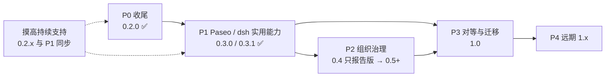
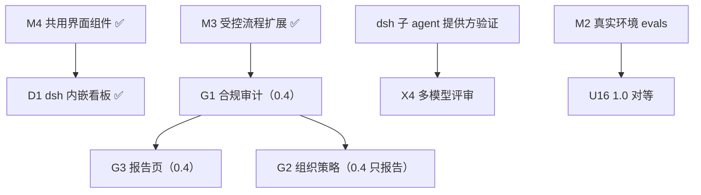

# laoshi 后续阶段 Roadmap

> 依据：`main`（`0.3.1-dev`，含 `0.2.0`、`0.3.0` 正式版与 `0.3.1-beta.2` 内网实机验证）、[抽取与实施计划](extraction/plan.md)、`docs/design/`、`docs/adr/`、各适配器 README，以及 2026-11-21 起的评审决定。
> 当前位置：`0.3.1` 一步安装/升级与文档收尾中；完成后即可发布 `0.3.1` 正式版并启动 **P2 组织治理（0.4 只报告版）**。

## 0. 已敲定的核心方向与决策

| 方向 / 决定 | 对 roadmap 的影响 |
|---|---|
| 摸高比赛已结束，但**平台继续支持**，专家在测试中 | 去掉参赛材料（原 U2）；摸高继续作为支持平台演进：MG-1～MG-3 纳入 `0.2.x`，MG-4 接入摸高原生通知能力，MG-5 并入 M3，MG-6 提升为三平台通用多仓能力 |
| **0.2.0 先发布** | P0 收尾后已发布 `0.2.0`（`latest`）并产出摸高专家包，之后继续演进 `0.2.x` 与 `0.3.0` / `0.3.1` |
| 不为 Claude Code、Codex 单独做适配，只适配更上层的 agent 平台（如 Paseo） | 命令行适配器（`adapters/cli`）**冻结**：保留现有代码作为一致性测试参照，不再加驱动、也不在真实命令行上跑 evals；去掉 OpenCode / Pi 驱动（原 U6）；**去掉本机调度**（原 U7）。想在 Claude Code、Codex 上跑，经由 Paseo 里已登录的 agent 来用 |
| 下一阶段重点：Paseo 和 dsh 的实用功能 | 新增第 3 节"平台能力对照与缺口"；P1 整体为 **Paseo / dsh 实用能力**（兼顾摸高通用增强） |
| **PR #18 与 M3 定位** | 关闭原 PR #18，已在 `main` 重做受控 **M3 流程扩展**（模式 B 留到 P4）：保留主流程骨架与核心步骤，允许挂载项目/安装级专属扩展步骤（支持 **AI 任务**如调用平台/项目 skill，以及**脚本类任务**） |
| **dsh 界面插件** | 通过共享 Web 看板与 `laoshi-dsh-plugin` 左侧栏内嵌视图（D1）+ 共用只读模型层（M4）统一 Paseo 与 dsh 的信息架构与全宽交互体验 |
| **dsh 内网 Node 版本** | 内网安装推荐使用 **Node 24**（同时保持 `>=22.19` 兼容） |
| **组织治理第一版强度** | P2 第一版（0.4）**先只做报告**（审计记录 + 报告页 + 策略报告模式），"按策略禁止"留到后续版本（0.5+）再评估 |

---

## 1. 现状（截至 0.3.1-dev）

- **核心与发布**：核心抽取（M1/M2）、`0.2.0`、`0.3.0` 与 `0.3.1-beta.2` 已发布；诊断包（`M1`）、版本号统一修改与专家打包自动化（`M6`）、受控流程扩展（`M3/MG-5`）、多仓联合开发增强（`X7` 引擎与界面）、预估与预算（`X3`）、改需求与转交（`X5`）均已合入 `main`。
- **Paseo（`0.11–0.17`）**：能力最完整，已在真实 Paseo `0.17` 验证插件界面与 `laoshi api`。支持一步安装/刷新 Paseo 需求插件（默认启用，可用 `--no-plugin` 跳过）、需求总览、等你处理（inbox）、全宽详情与步骤时间线、方案审查、回复、改需求、变更历史与转交、一键试用与验收清单、模型设置、使用统计。
- **DeepSeek Harness（dsh，`0.2.2-alpha.2` / `0.2.2-rc.5`）**：已在内网 Windows（`dsh 0.2.2-rc.5`）通过 `0.3.1-beta.2` 跑通真实需求全流程。`laoshi-dsh-plugin` 支持覆盖升级、内嵌左侧导航栏 **「需求看板（`/laoshi/`）」**、会话顶部栏 **「需求：<标题>」** 快捷跳转、阶段执行记录与原对话跳回、`expiresAt` 自动取消、`scheduleNewAgent`、`providerStatus`；共享 Web 看板已与 Paseo 对齐全宽详情、顶部 `需求 / 使用统计 / 配置` 切换及多仓视图；并支持与 Paseo 同机多平台并存及 `laoshi upgrade` 全平台同步刷新。仍待实机/补充：内网真实模型 `evals/` 基线（`U8`）、双仓并发实机走查（`U10`）、子 agent 多模型提供方实机验证（`X4`）、事件流替代轮询及浏览器能力检测。
- **摸高**：`MG-2`（长提示词兜底与轮次续跑衔接）、`MG-3`（统一停顿与"下一步该说什么"提示）已合入；`MG-1`（Java/mvn 沙箱完整实测报告）与 `MG-4`（原生通知接口调研与接入）待摸高实测推进。
- **命令行（`adapters/cli`）**：冻结。

---

## 2. 未完成项与进展追踪

### 2.1 P0 / P1 / P3 事项状态

| # | 事项 | 状态 | 归属 / 说明 |
|---|---|---|---|
| U4 | PR #36 的三个小问题（防重复安装、`req` 简写版本检查、`install.mjs` 退出码） | ✅ 已完成 | P0（`0.2.0` 前已合入） |
| U5 | 0.2.0 正式版与摸高专家包 | ✅ 已完成 | P0（`0.2.0` / `0.3.0` 已发布） |
| U9 | PR #18 拆解（**已定方案 a**）：关闭原 PR，重做受控流程扩展（M3）；模式 B 留 P4 | ✅ 已完成 | P0 关闭，M3 已在 P1（`0.3.0`）落地 |
| U11 | 代码库声明最低版本（`requiredVersion`）由 `doctor` 检查；升级前列出进行中的需求（[ADR 0007](adr/0007-one-install-many-repos.md) 决定 7） | ✅ 已完成 | `requiredVersion` 已在 `config.ts`/`doctor.ts`/`main.ts`；升级前运行中需求检查已在 `bin/bootstrap.mjs`（`0.3.1`）补齐 |
| U12 | [contracts/agent-runtime.md](../contracts/agent-runtime.md) 按 [ADR 0008](adr/0008-capability-sources-and-platform-plugin.md) 修订 | ✅ 已完成 | P1（`0.3.1` 已修订能力来源分层、方法表与后续预留） |
| U13 | 设计评审；ADR 0002/0003/0004/0006/0007/0008 定状态 | ✅ 已完成 | P1（`0.3.1` 已将 0004/0006/0007/0008 定为 `已采纳`，0002/0003 保留为 `提议`） |
| U8 | dsh：在内网用真实模型跑通 `evals/` 基线；确定 Windows 上的 shell 方案 | ⏳ 进行中（shell 已定） | P1（Windows 已定 `cmd.exe` + bash 插件并验证真实需求；真实模型 `evals/` 基线待跑通收集） |
| U10 | 同一安装根下两个代码库同时运行的端到端检查（用 Paseo 或 dsh 做） | ⏳ 待实机走查 | P1（多仓代码与索引已就绪，待内网/Paseo 并发实机记录） |
| U14 | req-kit 1.13 的 evals 基线 | ⏳ 待办 | P3 |
| U15 | 插件真实检查已提前完成；真实 1.x 安装迁移演练（含回滚）、转发薄 skill、paseo-req-kit 2.0 薄分发包 | ✅ 前半 / ⏳ 后半 | P1 已在真实 Paseo `0.17` 验完插件；1.x 迁移与 2.0 薄分发包留 P3 |
| U16 | 1.0 对等五条（见 [compat-migration.md](design/compat-migration.md) §4） | ⏳ 待办 | P3 |
| U18 | 内网文档站同步、对外材料改口径 | ⏳ 待办 | P3 |

### 2.2 摸高持续支持项（已定）

| # | 内容 | 状态 | 归属 |
|---|---|---|---|
| U1 / MG-1 | 摸高沙箱端到端验证闭环（含审批、轮次中断续跑、Java/mvn 项目），实测记录与修复沉淀进 [adapters/mogao/README.md](../adapters/mogao/README.md) | ⏳ 待沙箱实测闭环 | 0.2.x |
| U3 / MG-2 | 长提示词传给 `aimax run` 的长度上限兜底（过长改读文件）与单轮对话时限的续跑衔接 | ✅ 已完成 | 0.2.x（PR #43） |
| MG-3 | "下一步该说什么"统一提示（所有停顿点格式统一，引擎级改动） | ✅ 已完成 | 0.2.x（PR #44） |
| MG-4 | 接入摸高平台原生通知能力（先确认平台通知接口，在需要人决定或对话结束时主动提醒） | ⏳ 待接入 | P1 |

### 2.3 去掉或冻结

| # | 内容 | 处理 |
|---|---|---|
| ~~U2~~ | 摸高参赛材料 | 已去掉（比赛已结束） |
| ~~U6~~ | 真实命令行上的 evals、OpenCode / Pi 驱动 | 已去掉；命令行适配器冻结 |
| ~~U7~~ | 本机调度 | 已去掉；设计保留在 [builtin-capabilities.md](design/builtin-capabilities.md) §4，标为"不做" |
| U17 | M5 `laoshi init`（LLM 生成适配器） | 留在 P4，优先级再降：近期只服务 Paseo、dsh 这类平台，手写适配器够用 |

---

## 3. Paseo 和 dsh 的能力对照与缺口（截至 0.3.1-dev）

| 方面 | Paseo | dsh | 状态 / 剩余缺口 |
|---|---|---|---|
| 需求界面 | 插件（总览、inbox、全宽详情、审查、统计、设置） | 左侧导航栏内嵌 **「需求看板」**（`/laoshi/`）+ 会话顶部栏 **「需求：<标题>」** 快捷跳转 + 阶段执行记录跳转 | ✅ **D1 / M4 已对齐**：全宽详情与顶栏导航已与 Paseo 一致化 |
| 等你处理（确认方案 / 回答问题 / 审批） | 插件 inbox + 二次确认 | 内嵌看板置顶「需要你处理」（等待时长/紧急度/主操作） | ✅ **X1 已完成** |
| 试用、验收清单、代码审查页 | 详情页一键试用、逐条 AC 验收与外链审查页 | 详情页「验收工作台」一键试用、逐条 AC 勾选与提交结论 | ✅ **X2 已完成** |
| 改需求、变更历史、转交 | 插件发起改需求、倒序 `changes.md` / diff、转交负责人 | Web 看板「变更与接手」全宽子页（同步支持） | ✅ **X5 已提前完成** |
| 额度、用量提醒 | 平台额度 + `tokenUsage` + 预算预估 | 会话 `tokenUsage` + 预算预估 + `providerStatus`；平台额度仍为 `null` | ✅ **X3 / `providerStatus` 已完成**（平台额度 dsh 暂无接口） |
| 定时（预约、自动继续、定时总览） | Paseo 定时任务 | 插件 + dsh 定时任务（已补 `expiresAt` 到期自动取消与 `scheduleNewAgent`） | ✅ 已补齐并验证 |
| 一步安装与同机并存 | `npx ... install --platform paseo`（默认装插件，可 `--no-plugin`） | `npx ... install --platform dsh`（默认装插件与看板）；支持同机并存与 `laoshi upgrade` 同步刷新 | ✅ 已在 `0.3.1` 补齐 |
| 按角色用不同的 agent / 模型 | 从已登录的 agent 里选（Claude Code、Codex 等） | 按角色选模型（含子 agent 提供方），待实机验证多模型评审小组 | ⏳ **X4** 待真实 dsh 子 agent 提供方验证 |
| 等待步骤结束 | SDK 事件 | 轮询 `session/list` | ⏳ 待在真实 dsh 上确认插件事件流 API 后替换轮询 |
| 联合需求（多仓） | 原生 worktree/服务 + 插件展示 `joint` 分支与门禁 | 引擎 `joint.ts` + 内置 worktree/服务 + 看板多仓视图，缺真实多仓端到端验证 | ⏳ **X7** 待 dsh/摸高真实多仓端到端走查 |
| 浏览器能力（ui-check、看页面） | 看 agent 自己的能力 | 暂返回 `null` | ⏳ 待真实 dsh 插件探测 API 确认 |
| Windows（内网） | — | 已定 `cmd.exe` + bash 插件并在内网 `dsh 0.2.2-rc.5` 真实需求验证通过 | ✅ 真实需求闭环通过；⏳ `U8` `evals/` 基线待补 |

---

## 4. 功能扩展点（按角色，优先 Paseo / dsh 上的实用功能）

"落点"指功能在哪里出现：P = Paseo 插件，D = dsh 界面插件（共享 Web 看板），C = 两个平台共用的引擎部分。

### 4.1 使用者（测试、产品、项目经理：需求方）

| # | 扩展点 | 状态 | 说明 | 落点 |
|---|---|---|---|---|
| X1 | **集中处理"等我处理"的事** | ✅ `0.3.0` | 确认方案、回答业务问题、审批步骤操作，在置顶区展示等待时长与影响说明 | P、D |
| X2 | **验收工作台** | ✅ `0.3.0` | 详情页一键试用、逐条 AC 勾选与证据预览、提交 `acceptance.md` | P、D、C |
| X3 | **开工前预估和预算提醒** | ✅ `0.3.0` | 开工前与详情页展示历史同档位用时/token 预估，80% 提醒与超预算暂停 | P、D、C |
| X4 | **多模型评审小组能实际用起来** | ⏳ 部分完成 | Paseo 已有 `reviewPanel` 与 `doctor` 互补性检查；待 dsh 子 agent 多厂商提供方实机验证 | P、D、C |
| X5 | **改需求和接手更顺手** | ✅ `0.3.0` | 原列 P4，已提前交付：界面发起改需求、倒序历史与 diff 高亮、转交负责人 | P、D、C |
| X6 | **通知能力（含摸高原生通知）** | ⏳ 部分完成 | 通用停顿原因/下一步提示（`MG-3`）与外部 `notifiers` 已到位；待 `MG-4` 接入摸高原生通知 | C、摸高 |
| X7 | **多仓联合需求体验（三平台通用，MG-6）** | ⏳ 引擎与视图已完成 | 可配置 `maxJointRepos`、`/laoshi-setup` 自动发现关联仓、看板多仓视图已上线；待 dsh/摸高真实多仓 e2e | P、D、C、摸高 |

### 4.2 管理方（团队负责人、技术领导、质量负责人）—— 0.4（P2）重点

| # | 扩展点 | 状态 | 说明 | 落点 |
|---|---|---|---|---|
| G1 | **流程合规审计** | ⏳ P2（0.4） | 把跳过阶段、跳过评审/质量门、强行通过、绕过审批、改需求未重审等偏离定义为可追加、不可修改事件，记明谁、何时、理由 | C |
| G2 | **组织策略** | ⏳ P2（0.4 只报告，0.5+ 可选禁止） | 安装级配置 `policy`：必须人工评审的类型、门禁规则、模型白名单、预算上限、审批策略（收敛 dsh `approvals`） | C |
| G3 | **合规与效能报告页** | ⏳ P2（0.4） | 按人、代码库、时间汇总完成情况、偏离、交付周期、返工、上线问题与成本；接入 Paseo 与 dsh 统计页，支持导出/IM 定时发 | P、D |
| G4 | **团队汇总** | ⏳ P2 / P4 | 第一步各安装根导出与合并汇总（`stats --export / --merge` 已有基础）；第二步再评估只读汇总服务 | C |
| G5 | **安全事件汇总** | ⏳ P2（0.4） | 密钥扫描命中、危险命令拦截、审批批准/拒绝及理由，按代码库汇总 | P、D |
| G6 | **需求管理系统回写** | ⏳ 远期 | 卡片阶段、实际用时、合规结论回写到 ALM | C |

### 4.3 工具维护者

| # | 扩展点 | 状态 | 说明 |
|---|---|---|---|
| M1 | **诊断包** `laoshi diagnose <需求>` | ✅ `0.2.0` | 脱敏导出状态、提示词、日志、事件与版本包 |
| M2 | **Paseo / dsh 真实环境 evals** | ⏳ 待建常态基线 | 两个平台 × 一组模型跑 `evals/` 对比通过率、如实率、用时、成本 |
| M3 | **受控的流程扩展（含 MG-5）** | ✅ `0.3.0` | 保留主流程骨架，支持挂载项目/安装级 `extensions`（AI 任务与脚本任务）、Windows `cmd.exe` 兼容与 `doctor` 校验 |
| M4 | **两个界面共用组件与一致化体验** | ✅ `0.3.0–0.3.1` | 抽取共享只读/视图层，Web 看板全宽详情、顶部标签栏与 Paseo 插件保持一致 |
| M5 | **平台版本守护** | ✅ `0.3.0` | `package.json` 声明 `reqKit` 平台范围，`doctor` 自动校验 |
| M6 | **发布自动化** | ✅ `0.2.0` | 一条命令同步版本号、发版生成摸高专家包与 Windows 离线包 |
| M7 | **`pipeline.ts` 改成显式状态机** | ⏳ P4 | 模式 B 和更复杂动态流程所需 |
| M8 | **失败分类与经验回流** | ⏳ P4 | 统计失败类别并回流改进提示词 |

---

## 5. 分阶段路线

### P0：收尾并发布 0.2.0 —— ✅ 已完成

- U4、M1、M6、文档清理、U9（关闭旧 PR #18）、U5（`0.2.0` 与摸高专家包发布）全部完成。

### 0.2.x（摸高持续支持）

- ✅ **MG-2**：长提示词兜底与轮次续跑衔接（`0.2.x`）。
- ✅ **MG-3**：统一停顿提示格式（`0.2.x`）。
- ⏳ **MG-1**：摸高沙箱端到端闭环（含 Java/mvn、审批）实测沉淀进 [adapters/mogao/README.md](../adapters/mogao/README.md)。

### P1：Paseo / dsh 实用能力与通用增强（0.3.0 / 0.3.1）—— 主体已完成

- ✅ **0.3.0**：M4 共用组件、D1 共享 Web 看板、X1（集中待办）、X2（验收工作台）、X3（预估与预算）、X5（改需求与转交，提前交付）、M3（含 MG-5 受控流程扩展）、X7（多仓增强引擎与界面）、M5（版本守护）、Paseo `0.17` 与 dsh `0.2.2-rc.5` 实机适配。
- ✅ **0.3.1-beta.2 & 0.3.1 收尾**：dsh 插件内嵌左侧导航栏 + 会话顶部栏快捷跳转 + 执行记录直达、dsh 覆盖升级、Paseo + dsh 多平台并存、全宽详情与 Paseo 对齐、Paseo 默认一步装插件 + 多平台升级同步刷新、U11（升级前运行中需求检查）、U12（契约同步 ADR 0008）、U13（ADR 0004/0006/0007/0008 定状态）。
- ⏳ **余下实机验证 / 专项补齐**：U8（内网真实模型 `evals/`）、U10（双仓并发实机走查）、X4（dsh 子 agent 多模型验证）、X7（dsh/摸高多仓 e2e）、MG-4（摸高原生通知）、dsh 事件流替代轮询与浏览器探测。

### P2：组织治理，0.4～0.5（下一重点阶段，先写设计）

1. 设计文档（[governance.md](design/governance.md)）与评审：审计事件清单、合规规则、报告结构、与 ADR 0007 团队版的关系（第一版定位"只报告"，为后续"禁止"模式预留策略结构）。
2. **0.4（只报告版）**：G1 审计事件（追加写）→ G3 合规与效能报告页（Paseo 与 dsh 共用视图）→ G2 策略（只报告模式）→ G5 安全事件汇总、G4 团队汇总第一步。
3. **0.5+（按需演进）**：结合 0.4 实际使用反馈，再决定是否引入防篡改哈希链与"按策略禁止"拦截模式。

**完成标准**：用一个团队的真实数据，在 Paseo 或 dsh 界面上看到按人和代码库的合规与效能报告，能够清晰列出阶段完成情况与各类偏离记录（谁、何时、理由）。

### P3：对等与迁移，1.0

U14、U15（1.x 迁移演练与薄转发包）、U16（[compat-migration.md](design/compat-migration.md) §4 五条对等）、U18。

### P4：远期（1.x）

M7 状态机 → 模式 B（[ADR 0002](adr/0002-two-orchestration-modes.md)，有条件）；U17 `laoshi init`；G4 第二步（汇总服务）；G6 ALM 回写；M8 失败分类。（原排在 P4 的 X5 已于 `0.3.0` 提前完成。）

---

## 6. 关键依赖

