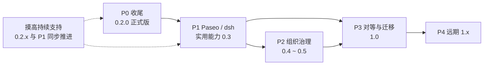
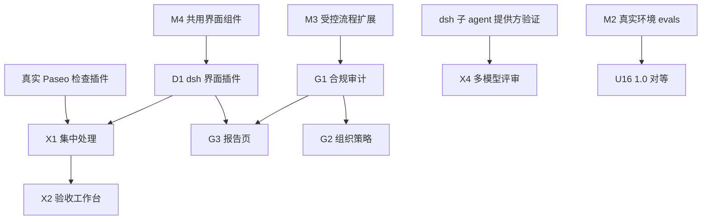

# laoshi 后续阶段 Roadmap

> 依据：`main`（`8dd60de`，含 PR #36）上的[抽取与实施计划](extraction/plan.md)、`docs/design/`、`docs/adr/`、各适配器 README、PR #18，以及 2026-11-21 的评审决定。

## 0. 已敲定的核心方向与决策

| 方向 / 决定 | 对 roadmap 的影响 |
|---|---|
| 摸高比赛已结束，但**平台继续支持**，专家在测试中 | 去掉参赛材料（原 U2）；摸高继续作为支持平台演进：MG-1～MG-3 纳入 `0.2.x`，MG-4 接入摸高原生通知能力，MG-5 并入 M3，MG-6 提升为三平台通用多仓能力 |
| **0.2.0 先发布** | P0 收尾后立即发 0.2.0（`latest`）并产出摸高专家包，让摸高沙箱能测试到最新版本；测试中发现的问题放进 `0.2.x` |
| 不为 Claude Code、Codex 单独做适配，只适配更上层的 agent 平台（如 Paseo） | 命令行适配器（`adapters/cli`）**冻结**：保留现有代码，它仍是一致性测试的参照，但不再加驱动、也不在真实命令行上跑 evals；去掉 OpenCode / Pi 驱动（原 U6）；**去掉本机调度**（原 U7，它的唯一用户是命令行适配器，Paseo 和 dsh 都有自己的定时任务）。想在 Claude Code、Codex 上跑，经由 Paseo 里已登录的 agent 来用 |
| 下一阶段重点：Paseo 和 dsh 的实用功能 | 新增第 3 节"平台能力对照与缺口"；P1 整体为 **Paseo / dsh 实用能力**（兼顾摸高通用增强） |
| **PR #18 与 M3 定位** | 关闭原 PR #18，在当前 `main` 上重做 **M3 流程扩展**（模式 B 留到 P4）。**第一版不做完全开放式编排**：保留主流程骨架与核心步骤，允许在主流程之外挂载专属扩展步骤（支持 **AI 任务**如调用平台/项目 skill，以及**脚本类任务**） |
| **dsh 界面插件** | 做 dsh 界面插件（D1），与 Paseo 插件**合并共用**核心界面组件（先抽 M4 共用视图层） |
| **dsh 内网 Node 版本** | 内网安装 **Node 24**（不再兼容 dsh 声明范围之外的 Node 22.20，写入安装说明与脚本） |
| **组织治理第一版强度** | P2 第一版（0.4）**先只做报告**（审计记录 + 报告页 + 策略报告模式），"按策略禁止"留到后续版本（0.5+）再评估 |

---

## 1. 现状

- 核心抽取（M1/M2）、0.1.x 发布、`laoshi migrate`、Paseo 插件迁入都已完成。
- **Paseo**：能力最完整。插件已有需求总览、等你处理（inbox）、需求详情和步骤时间线、方案审查、回复、审批、确认 / 停止 / 继续 / 开始测试验证、模型设置、使用统计。但迁入 laoshi 后**还没有在真实 Paseo 上检查过**。
- **dsh**：必需能力、对话下的子 agent、定时消息、审批策略、内置 worktree 和服务、按角色选模型都有了，但**没有界面**（需求总览只能用 `laoshi api` 和本机网页）。另外，额度、profile、provider 状态返回 `null`；联合需求没有做过端到端检查；Windows 上也没有跑过端到端检查。
- **摸高**：0.2.0-beta.3 加上 #36，专家在测试中。
- **命令行**：冻结。

---

## 2. 未完成项（重新归类）

### 2.1 保留

| # | 未完成项 | 归属 |
|---|---|---|
| U4 | PR #36 留下的三个小问题：装不上时会重复安装、`req …` 简写的命令不带版本、没有检查 `install.mjs` 的退出码 | P0 |
| U5 | 0.2.0 正式版（`latest` 现在仍是 0.1.1）。**先发布**，让摸高测试能用到最新版本；后续反馈进 0.2.x | P0 |
| U9 | PR #18 拆解（**已定方案 a**）：关闭原 PR，在当前 `main` 上重做受控流程扩展（M3）；模式 B 留到 P4 | P0 关闭，P1 实施 |
| U8 | dsh：在内网（安装 Node 24）用真实模型跑 `evals/`；确定 Windows 上的 shell 方案 | P1 |
| U10 | 同一安装根下两个代码库同时运行的端到端检查（用 Paseo 或 dsh 做） | P1 |
| U11 | 代码库声明 laoshi 最低版本，由 `doctor` 检查；升级前列出进行中的需求（[ADR 0007](adr/0007-one-install-many-repos.md) 决定 7，代码里没找到实现，**待核实**） | P1 |
| U12 | [contracts/agent-runtime.md](../contracts/agent-runtime.md) 按 [ADR 0008](adr/0008-capability-sources-and-platform-plugin.md) 修订 | P1 |
| U13 | 设计评审；ADR 0002/0003/0004/0006/0007/0008 定状态 | P1 顺带 |
| U14 | req-kit 1.13 的 evals 基线 | P3 |
| U15 | 在真实 1.x 安装上演练迁移（含回滚）、转发用的薄 skill、paseo-req-kit 2.0 薄分发包。**其中"在真实 Paseo 上检查插件界面"提前到 P1**，因为 P1 的 Paseo 功能都建立在这个插件上 | P1 / P3 |
| U16 | 1.0 对等五条（见 [compat-migration.md](design/compat-migration.md) §4） | P3 |
| U18 | 内网文档站同步、对外材料改口径 | P3 |

### 2.2 摸高持续支持项（已定）

| # | 内容 | 归属 |
|---|---|---|
| U1 / MG-1 | 摸高沙箱端到端验证闭环（含审批、轮次中断续跑、Java/mvn 项目），实测记录与修复沉淀进 [adapters/mogao/README.md](../adapters/mogao/README.md) | 0.2.x |
| U3 / MG-2 | 长提示词传给 `aimax run` 的长度上限兜底（过长改读文件）与单轮对话时限的续跑衔接 | 0.2.x |
| MG-3 | "下一步该说什么"统一提示（所有停顿点格式统一，引擎级改动，摸高收益最大） | 0.2.x |
| MG-4 | 接入摸高平台原生通知能力（先确认平台通知接口，在需要人决定或对话结束时主动提醒） | P1 |

### 2.3 去掉或冻结

| # | 内容 | 处理 |
|---|---|---|
| ~~U2~~ | 摸高参赛材料 | 去掉（比赛已结束） |
| ~~U6~~ | 真实命令行上的 evals、OpenCode / Pi 驱动 | 去掉；命令行适配器冻结 |
| ~~U7~~ | 本机调度 | 去掉；设计保留在 [builtin-capabilities.md](design/builtin-capabilities.md) §4，标为"不做" |
| U17 | M5 `laoshi init`（LLM 生成适配器） | 留在 P4，优先级再降：近期只服务 Paseo、dsh 这类平台，手写适配器够用 |

> 注：需要同步修改的文档：[plan.md](extraction/plan.md) 里 M3 的完成标准和"待做"、[builtin-capabilities.md](design/builtin-capabilities.md) 的状态、[cli-adapter.md](design/cli-adapter.md) 加上"冻结"说明、`README.md` 的平台列表、[dsh-adapter.md](design/dsh-adapter.md) §8 记入已定项。这些放进 P0。

---

## 3. Paseo 和 dsh 的能力对照与缺口

| 方面 | Paseo | dsh | 缺口 / 机会 |
|---|---|---|---|
| 需求界面 | 插件（总览、inbox、详情、审查、统计、模型设置） | **没有**；`laoshi api` 加本机网页 | **D1** dsh 界面插件（dsh 的 web 界面支持插件，与 Paseo 共用组件） |
| 等你处理（确认方案 / 回答问题 / 审批） | 插件里有 inbox | 在对话里提醒，审批要到 dsh 界面里点 | 两个平台都在界面上集中处理 |
| 试用、验收清单、代码审查页 | 只能用命令或另开网页（`try`、`checklist`、`code-review`），插件里没有 | 同左 | **X2** 放进需求详情页 |
| 额度、用量提醒 | 有额度 | 只有每个会话的 `tokenUsage`；额度、provider 状态返回 `null` | dsh 补 `providerStatus` 和用量预警；两边都做预算提醒 |
| 定时（预约、自动继续、定时总览） | Paseo 定时任务 | 插件 + dsh 定时任务；`expiresAt` 被忽略，`scheduleNewAgent` 没有验证 | dsh 补上截止时间，验证 `scheduleNewAgent` |
| 按角色用不同的 agent / 模型 | 从已登录的 agent 里选（Claude Code、Codex 等就是在这里用上的） | 按角色选模型；用不同 harness 要挂子 agent 提供方，**没有验证**（[dsh-adapter.md](design/dsh-adapter.md) §8-3） | **X4** 多模型评审小组在两个平台都能实际用起来 |
| 等待步骤结束 | SDK 事件 | 轮询 `session/list` | dsh 改成订阅事件流（更及时，也更省资源） |
| 联合需求（多仓） | **基础已完备**（原生 worktree/服务 + 插件 `detail.tsx` 已展示 `joint` 分支与质量门） | 引擎 `joint.ts` + 内置 worktree/服务已通单元测试，**缺端到端验证与界面展示** | **X7** 提升为三平台通用能力（含摸高 `repos/`）：补齐 dsh/摸高端到端、可配置仓库上限、关联仓发现与多仓验收视图 |
| 浏览器能力（ui-check、看页面） | 看 agent 自己的能力 | `capabilities` 根据 `browser-use` 等插件判断，**没有验证** | 检测到浏览器能力时，验证步骤自动用上 |
| Windows（内网） | — | shell 方案没定，Windows 上没跑过端到端 | U8 |
| 真实环境检查 | 迁入后插件界面没检查过 | 只有模拟模型的端到端 | 两个平台各跑一次真实需求 |

---

## 4. 功能扩展点（按角色，优先 Paseo / dsh 上的实用功能）

"落点"指功能在哪里出现：P = Paseo 插件，D = dsh 界面插件，C = 两个平台共用的引擎部分。

### 4.1 使用者（测试、产品、项目经理：需求方）

| # | 扩展点 | 说明 | 落点 | 价值 / 成本 |
|---|---|---|---|---|
| X1 | **集中处理"等我处理"的事** | 确认方案、回答业务问题、审批步骤的操作、验收，都在界面的一个列表里完成，并说明"不处理会怎样"（例如流水线停在哪一步、已经等了多久）。Paseo 在现有 inbox 上补齐；dsh 随 D1 一起做 | P、D | **高 / 中** |
| X2 | **验收工作台** | 需求详情页上一键试用（启动服务，给出地址和测试数据）、验收清单逐条勾选、每条验收标准附上证据（执行的命令、关键输出、`ui-check` 截图）、看代码改动，最后提交验收结论 | P、D、C | **高 / 中** |
| X3 | **开工前预估和预算提醒** | 确认 spec 时给出预计用时、token、费用区间，并参考同类需求的历史数据；运行中用到 80% 时提醒，用完时停下等人决定。Paseo 结合额度；dsh 结合 `tokenUsage` | P、D、C | 中 / 低 |
| X4 | **多模型评审小组能实际用起来** | 评审步骤让不同厂商的模型各自独立评审，再汇总（`reviewPanel` 已有）。Paseo 上从已登录的 agent 里选；dsh 上验证并接入子 agent 提供方。设置页可以直接配置 | P、D、C | 高 / 中 |
| X5 | **改需求和接手更顺手** | 界面上可以发起"改需求"（暂停 → 对齐变化 → 新版本 → 继续），也可以看到需求的变更历史和差异；把需求转给同事接手 | P、D | 中 / 中 |
| X6 | **通知能力（含摸高原生通知）** | 到了需要人决定的点，通过平台原生通知或外部 IM/邮件提醒（对话已关掉或无推送时最需要）；**摸高优先调研并接入平台专门的通知能力（MG-4）** | C、摸高 | 中 / 低 |
| X7 | **多仓联合需求体验（三平台通用，MG-6）** | 经核实，核心 `engine/src/joint.ts` 与 Paseo（原生 worktree/服务 + 插件 `detail.tsx` 展示 `joint`）已提供基础能力，dsh 和摸高也已声明内置 worktree/服务。下一步补齐：**① dsh 与摸高（`repos/` 目录）真实端到端验证；② 放开硬编码 `MAX_JOINT = 2` 为可配置上限；③ `/laoshi-setup` 自动发现同工作区关联仓减少 `relatedRepos` 手工配置；④ 共用界面补齐多仓改动与合并清单视角** | P、D、C、摸高 | 高 / 中 |

### 4.2 管理方（团队负责人、技术领导、质量负责人）

| # | 扩展点 | 说明 | 落点 | 价值 / 成本 |
|---|---|---|---|---|
| G1 | **流程合规审计** | 把"偏离流程"定义成可以检查的规则：跳过阶段、跳过评审或质量门、强行通过、绕过审批、改需求后没有重新确认。发生时记一条**只能追加、不能修改**的事件，写明谁、什么时候、理由是什么 | C | **高 / 中** |
| G2 | **组织策略** | 安装级配置 `policy`：哪些类型必须人工评审、哪些门不建议跳过、模型白名单、预算上限、审批策略（dsh 插件的 `approvals` 并进来）。**第一版只做报告**（偏离时标记并汇总），后续版本再考虑支持"禁止"模式 | C | 高 / 中 |
| G3 | **合规与效能报告页** | 按人、代码库、时间汇总：阶段完成情况、偏离次数和理由、交付周期、返工、等待、上线后的问题、成本。放在 Paseo 插件的统计页，也放在 dsh 界面插件里；可以导出，也可以定时发到 IM | P、D | 高 / 低（G1 之后） |
| G4 | **团队汇总** | 第一步：各安装根导出，统一合并（`stats --export / --merge`）；第二步再考虑只读的汇总服务 | C | 中 / 中 |
| G5 | **安全事件汇总** | 密钥扫描命中、危险命令拦截、审批的批准或拒绝及理由，按代码库汇总 | P、D | 中 / 低 |
| G6 | **需求管理系统回写** | 卡片的阶段、实际用时、合规结论回写到 ALM | C | 中 / 中 |

### 4.3 工具维护者

| # | 扩展点 | 说明 | 价值 / 成本 |
|---|---|---|---|
| M1 | **诊断包** `laoshi diagnose <需求>` | 状态、各步骤的提示词、输出尾部、事件 / 回调、工具调用时间线、版本，**脱敏后**打成一个包。对摸高测试反馈、Paseo、dsh 都有用 | **高 / 低** |
| M2 | **Paseo / dsh 真实环境 evals** | 两个平台 × 一组模型，发版前跑 `evals/`，和上一版比较通过率、如实率、用时、成本；改了提示词或流程必须跑 | **高 / 中** |
| M3 | **受控的流程扩展（重做 PR #18，并入 MG-5）** | **第一版不做完全开放式编排**：保留主流程骨架与核心阶段，允许在主流程之外挂载项目/安装级专属步骤，支持两类任务——**AI 任务**（如调用摸高 SDD/PRD/测试用例 skill 或项目自定义 skill）与**脚本类任务**（如自定义校验、构建、同步脚本）。配套 `doctor` 校验，同时作为 G1 合规检查的依据；模式 B 留到 P4 | 高 / 中 |
| M4 | **两个界面共用一套组件** | 把 Paseo 插件的 `client/`（总览、详情、inbox、统计）抽成和平台无关的视图层，Paseo 插件和 dsh 界面插件都用它，避免维护两份界面 | 高 / 中（D1 的前提） |
| M5 | **平台版本守护** | Paseo daemon、dsh（开发者预览，接口会变）各自声明支持的版本范围，由 `doctor` 检查；用真实输出录下的假平台做契约测试 | 中 / 低 |
| M6 | **发布自动化** | 一条命令改所有版本号（现在每次都要手动改 5 处，再改回 `-dev`）；发版时自动生成摸高专家包、Paseo 插件、dsh 插件 | 中 / 低 |
| M7 | **`pipeline.ts` 改成显式状态机** | 模式 B 和更复杂的流程需要它 | 中 / 高（P4） |
| M8 | **失败分类与经验回流** | 统计失败的类别（上下文占满、限流、平台进程挂住、质量门不过、结果文件格式不对）；复盘的结论回到提示词，再用 M2 验证 | 中 / 中 |

---

## 5. 分阶段路线

### P0：收尾并发布 0.2.0（约 1 周），紧接 0.2.x 摸高实战打磨

**P0（发 0.2.0 之前）：**
- U4：PR #36 的三个小问题。
- M1：诊断包的最小版本（只打包和脱敏），便于摸高测试反馈排查。
- M6：版本号一条命令改完，并支持自动打摸高专家包。
- 文档调整：命令行冻结、去掉本机调度、去掉参赛材料（第 2.3 节），dsh 内网安装指南明确要求 Node 24，dsh-adapter §8 记入已定项。
- U9：关闭旧 PR #18，备注拆解与新设计方向（保留主流程 + 外部扩展步骤）。
- U5：**发布 0.2.0（`latest`）并产出对应摸高专家包**，供摸高沙箱测试最新版本。

**0.2.x（随摸高测试推进，与 P1 前期并行）：**
- MG-1：摸高沙箱端到端验证闭环（审批、轮次中断续跑、Java/mvn 项目）并沉淀到 `adapters/mogao/README.md`。
- MG-2：长提示词传给 `aimax run` 的长度上限与对话时限兜底。
- MG-3："下一步该说什么"统一提示（引擎级统一停顿提示格式）。

### P1：Paseo / dsh 实用能力与通用增强，0.3（约 4～6 周）

**第一步：打好基础（约 1～2 周）**
- U15（前半）：在真实 Paseo 上检查插件界面；U8：dsh 在内网（Node 24）用真实模型跑 evals、定 Windows shell 方案。
- M2：两个平台的 evals 流程（先手动触发）。
- M4：把 Paseo 插件界面组件抽成平台无关的共用视图层（供 Paseo 与 dsh 合并共用）。
- M5：平台版本守护。

**第二步：实用功能（约 3～4 周，按价值排序）**
1. **X1** 集中处理"等我处理"的事（Paseo 补齐）。
2. **D1** dsh 界面插件第一版（基于 M4 共用组件）：总览、详情、等我处理、确认 / 停止 / 继续 / 开始验证，和 Paseo 插件功能一致。
3. **X2** 验收工作台（两个平台共用）。
4. **X4** 多模型评审小组：Paseo 从已登录的 agent 里选；dsh 验证子 agent 提供方。
5. **X3** 预估与预算提醒；dsh 补 `providerStatus`、用量预警。
6. **X7** 多仓联合需求体验升级（dsh 与摸高端到端验证、可配置仓库上限、关联仓自动发现、共用界面多仓视图）。
7. **X6 / MG-4** 通知能力：接入摸高平台原生通知能力，并完善通用外部通知。
8. dsh 的其他缺口：定时任务的截止时间、`scheduleNewAgent`、事件流代替轮询、浏览器能力检测。
9. **M3（含 MG-5）** 受控的流程扩展（保留主流程步骤 + 挂载 AI/skill 任务与脚本类任务）。
10. U10、U11、U12、U13 顺带做掉。

**完成标准**：
- Paseo 和 dsh 各用真实模型完整跑通至少一个真实需求和一个 `evals/` 用例，"夸大"为零。
- dsh 有界面插件且与 Paseo 共用核心视图组件，需求总览、等我处理、主要操作一致。
- 两个平台的需求详情里都能完成试用、逐条验收和提交结论。

### P2：组织治理，0.4～0.5（约 3～5 周，先写设计）

1. 设计文档和评审：审计事件清单、合规规则、报告的样子、和 ADR 0007 团队版的关系（第一版定位"只报告"，为后续"禁止"模式预留策略结构）。
2. **0.4（只报告版）**：G1 审计事件（追加写）→ G3 合规与效能报告页（Paseo 与 dsh 共用组件）→ G2 策略（只报告模式）→ G5 安全事件汇总、G4 团队汇总第一步。
3. **0.5+（按需演进）**：结合 0.4 实际使用反馈，再决定是否引入防篡改哈希链与"按策略禁止"拦截模式。

**完成标准**：用一个团队的真实数据，在 Paseo 或 dsh 界面上看到按人和代码库的合规与效能报告，能够清晰列出阶段完成情况与各类偏离记录（谁、何时、理由）。

### P3：对等与迁移，1.0（约 3～4 周，可以和 P2 后半并行）

U14、U15（后半）、U16、U18。完成标准：[compat-migration.md](design/compat-migration.md) §4 的五条全部满足，发 1.0.0，paseo-req-kit 2.0 依赖 `laoshi@^1`。

### P4：远期（1.x）

M7 状态机 → 模式 B（[ADR 0002](adr/0002-two-orchestration-modes.md)，有条件）；U17 `laoshi init`；G4 第二步（汇总服务）；G6 ALM 回写；X5 改需求和接手；M8 失败分类。

---

## 6. 关键依赖

两条最关键：
1. **dsh 的实用功能大多要有界面才用得上**，所以先抽出共用的界面组件（M4），再做 dsh 界面插件（D1），后面的 X1、X2、G3 才能两个平台同时上线，不会做两遍。
2. **合规检查要有明确的流程定义作依据**，所以受控流程扩展（M3）排在合规审计（G1）前面。

---

## 7. 全部决策记录

1. **PR #18 与 M3 流程扩展**：关闭原 PR，在当前 `main` 上重做 M3（模式 B 留到 P4）；**第一版不做完全开放式编排**，保留主流程步骤，在主流程之外支持挂载专属步骤（AI/skill 任务如摸高场景 skill，或脚本类任务）。
2. **dsh 界面插件**：做 dsh 界面插件，并与 Paseo 插件**合并共用**核心界面组件（先抽 M4）。
3. **dsh 内网 Node 版本**：内网安装 **Node 24**。
4. **组织治理第一版强度**：**先做报告**（0.4），后续再根据使用情况考虑"禁止"模式（0.5+）。
5. **0.2.0 正式版发布时机**：**先发布 0.2.0**（含摸高专家包），供摸高测试最新版本；测试反馈与 MG-1～MG-3 放进 `0.2.x`。
6. **摸高持续支持项**：
   - `MG-1`（沙箱端到端闭环）、`MG-2`（长提示词与时限兜底）、`MG-3`（"下一步该说什么"统一提示）→ 纳入 `0.2.x`。
   - `MG-4`（通知）→ 调研并接入**摸高平台专门的通知能力**，纳入 P1（与 X6 统一）。
   - `MG-5`（复用摸高场景 skill）→ 并入 P1 的 **M3** 统一设计。
   - `MG-6`（多仓需求）→ 提升为 Paseo / dsh / 摸高三平台**通用能力 X7**，纳入 P1。

> 注：周期按一个人全职粗估，需按实际人手调整；U11 根据代码搜索判断为尚未实现，排入 P1 时再核实。
